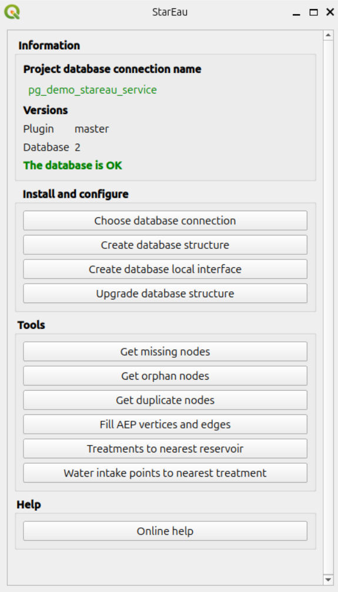

---
hide:
  - navigation
  - toc
---

# StarEau plugin

The StarEau plugin helps to manage the data of **underground water networks**
(drinking water, wastewater and stormwater) with **QGIS** and **PostGIS**,
in accordance with the French **StaR'Eau** geostandard.

* [Concepts](./concepts/)
* [Installation](./installation/)
* [User guide](./user-guide/)
* [Changelog](./changelog/)
* Database
    * [Tables and fields](./database-guide/tables/)
    * [Useful functions](./database-guide/functions/)
    * [Database structure](./database-guide/structure/)
