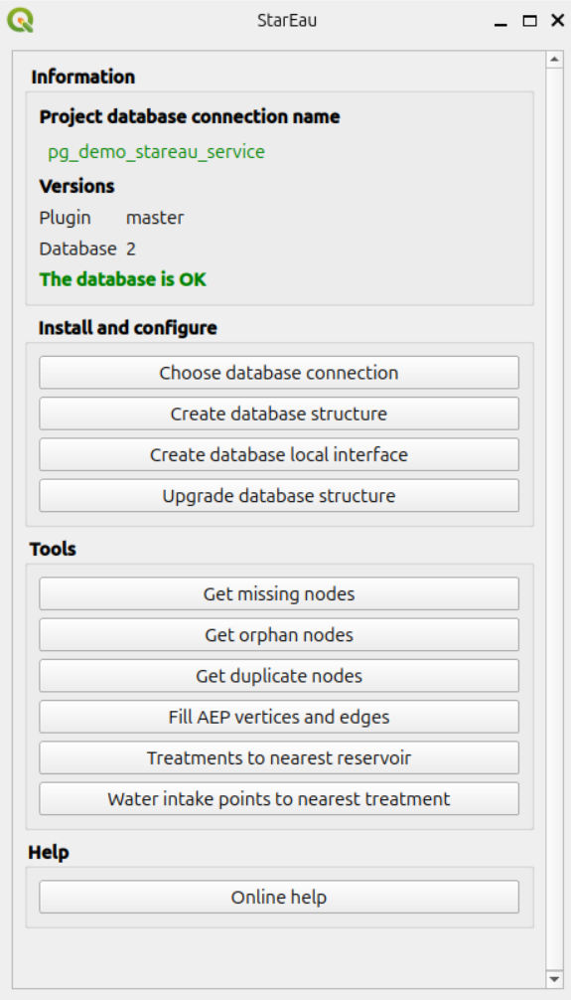
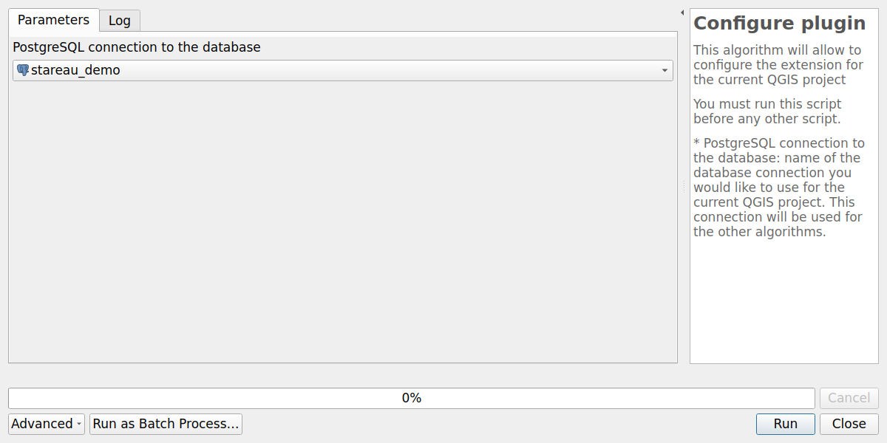
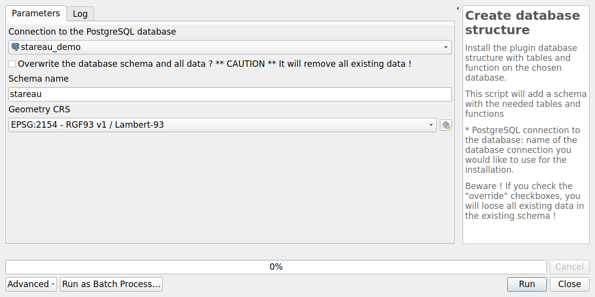
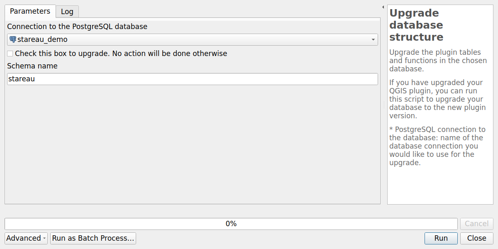
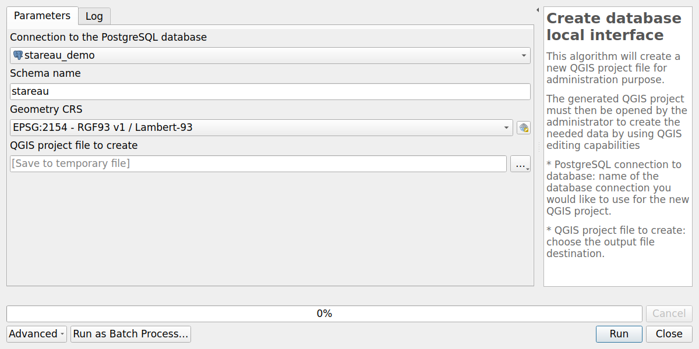

# Introduction

To use the plugin, you need to:

* install QGIS Desktop
* install the plugin for QGIS
* add a connection to a PostgreSQL database with the PostGIS extension
* install the database structure on this PostgreSQL database
* create the QGIS administration project

## Get QGIS Desktop

The administrator must use the **QGIS desktop software**, version 3.34.x or above.

You can download QGIS in the [official download page](https://qgis.org/fr/site/forusers/download.html)

## Install the plugin

At present, the plugin is not yet in QGIS official plugin repository, and it is **experimental**.
To install the plugin, you need to:

* open QGIS **Plugin manager** (menu `Plugins`),
* in the **Settings** tab:
    * check the box `Show also experimental plugins`,
    * add a new repository with the URL
      `https://github.com/3liz/qgis-stareau-plugin/releases/latest/download/plugins.xml`,
* in the **All** tab, search for the word `StarEau` and install the **StarEau** plugin.

After a successful installation, you should see a new dock called **StarEau**



For further details, you can have a look at [3liz documentation web page](https://3liz.github.io/add_qgis_repository.html).

## Prepare the PostgreSQL database

The plugin stores all the data in a **PostgreSQL database**, with the **PostGIS** extension installed (to manage spatial data).

You need to have access to a PostgreSQL database, with enough rights to create **schemas**,
**tables** and **extensions**. The installation creates the extensions `postgis`, `uuid-ossp` and `hstore`
if they do not exist yet.

### pgRouting

The [network analysis](../user-guide/network-analysis.md) tools of the drinking water network
need the **pgRouting** extension. It is not created by the plugin: a database administrator
must install the pgRouting package on the server, then create the extension in the database:

```sql
CREATE EXTENSION IF NOT EXISTS pgrouting;
```

The functions use `pgr_bdDijkstra`, `pgr_withPoints`, `pgr_trsp` and `pgr_findCloseEdges`:
use a recent version of pgRouting (3.4 or above). The plugin is tested with
**PostgreSQL 17** and **pgRouting 4**.

The other tools of the plugin work without pgRouting.

### Add a connection in QGIS

In QGIS, use the **Datasource manager** under the **Layer** menu to create a new PostgreSQL connection:

* Activate the **PostgreSQL tab** (elephant icon)
* Click on the **New** button
* In the creation dialog, fill the needed information, and use the **Test connection** button to make sure the credentials are ok.

We advise to:

* use a **service connection** instead of the basic authentication. See [QGIS documentation](https://docs.qgis.org/latest/en/docs/user_manual/managing_data_source/opening_data.html#postgresql-service-connection-file)
* check the boxes `Use estimated table metadata` and `Also list tables with no geometry`

Once your connection is set up, you can create the database structure in your PostgreSQL database.

The algorithms below are available in the **Processing toolbox**, provider `StarEau`,
and with the buttons of the group `Install and configure` of the **StarEau** panel.

## Configure the plugin

This algorithm will allow to configure the extension for the current QGIS project.

You must run this script before any other script.



Parameters:

* `PostgreSQL connection to the database`: name of the database connection you would like to use for the current QGIS project.
  This connection will be used by default by the other algorithms.

The connection name is stored in the project variable `stareau_connection_name`:
save the QGIS project to keep it.

## Create the database structure

Install the database structure with tables and functions on the chosen database connection.



Parameters:

* `Connection to the PostgreSQL database`: name of the database connection you would like to use for the installation.
* `Overwrite the database schema and all data ?`: if the schema already exists in the database,
  the algorithm stops with an error, unless this box is checked.
  In this case, the existing schemas are **dropped with all their data** and created again.
  Unchecked by default.
* `Schema name`: prefix of the schemas to create. Default: `stareau`.
* `Geometry CRS`: coordinate reference system of the geometries stored in the database.
  It must be a valid EPSG code. Default: `EPSG:2154 - RGF93 v1 / Lambert-93`.

The algorithm creates the following schemas, prefixed by the chosen schema name:

| Schema | Content |
|--------|---------|
| `stareau` | Functions and triggers of the plugin, routing graph and metadata |
| `stareau_principale` | Parent tables: network nodes, pipes, common fields |
| `stareau_commun` | Tables shared by the AEP and ASS networks: rain gauges, piezometers, geolocation points |
| `stareau_aep` | Drinking water network |
| `stareau_aep_brcht` | Drinking water service connections |
| `stareau_ass` | Sanitation network |
| `stareau_ass_brcht` | Sanitation service connections |
| `stareau_defense_incendie` | Fire water points (PEI) |
| `stareau_valeur` | Value lists |

Then it fills the **value lists** of the schema `stareau_valeur`, and stores the version
of the database structure in the table `stareau.metadata`.

See [Tables and fields](../database-guide/tables.md) for the description of the schemas and tables.

## Upgrade database structure

Upgrade the tables and functions in the chosen database.

If you have upgraded your QGIS plugin, you can run this script to upgrade your database to the new plugin version.
The **StarEau** panel shows if an upgrade is needed, see [Administration panel](../user-guide/qgis-project.md#administration-panel).



Parameters:

* `Connection to the PostgreSQL database`: name of the database connection you would like to use for the upgrade.
* `Check this box to upgrade. No action will be done otherwise`: safety checkbox.
  The algorithm refuses to run if it is not checked.
* `Schema name`: prefix of the schemas to upgrade. Default: `stareau`.

The algorithm reads the version of the database structure in the table `stareau.metadata`,
then runs the upgrade scripts of the newer versions, one by one.
Nothing is done if the database is already up to date.

## Create your database local interface

This algorithm will create a **new QGIS project file** for administration purpose.

The generated QGIS project must then be opened by the administrator
to **create and edit the network data** by using QGIS editing capabilities.



Parameters:

* `Connection to the PostgreSQL database`: name of the database connection
  you would like to use for the new QGIS project.
* `Schema name`: prefix of the schemas installed with the algorithm `Create database structure`.
  Default: `stareau`. The schema must exist in the database.
* `Geometry CRS`: coordinate reference system of the QGIS project and its layers.
  Use the same CRS as the one chosen when creating the database structure.
  Default: `EPSG:2154 - RGF93 v1 / Lambert-93`.
* `QGIS project file to create`: choose the output file destination, with the extension `.qgs`.
  We advise you to choose a name reflecting the database name.

You can then open the generated QGIS project, see [Administration project](../user-guide/qgis-project.md#administration-project).
