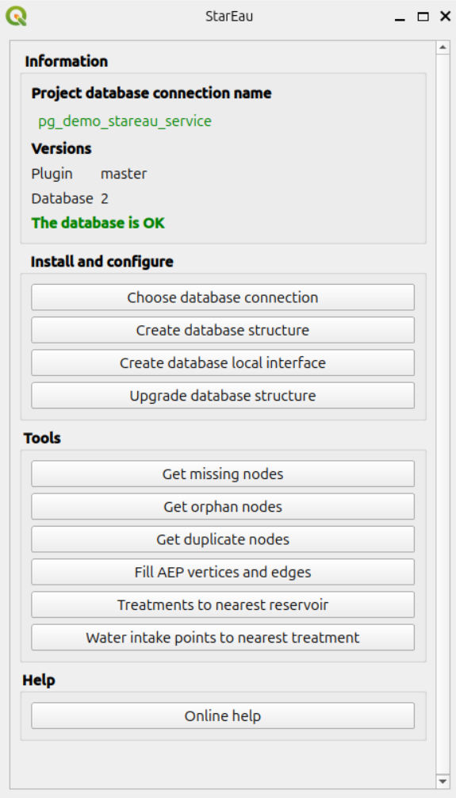

# User guide

The StarEau plugin stores the network data and most of the business logic **inside a PostgreSQL database**,
following the StaR'Eau geostandard.
The QGIS plugin helps to create and upgrade this database, to create a QGIS project
to edit the data, to check the quality of the network and to analyse it.

This guide is split in four parts:

* [QGIS project and tools](qgis-project.md): the administration project, the panel of the plugin,
  and the actions available on the layers.
* [Processing algorithms](processing.md): the algorithms provided by the plugin.
* [Network topology](topology.md): how the database keeps the links between the pipes and the nodes
  when the data is edited.
* [Network analysis](network-analysis.md): the routing graph of the drinking water network
  and the tools based on pgRouting.

## Database model

All the data is stored inside a **PostgreSQL database**:

* the **tables of the StaR'Eau geostandard**, split in several schemas: `stareau_principale`,
  `stareau_aep`, `stareau_ass`, `stareau_valeur`, etc.,
* the schema `stareau` of the plugin, which contains:
    * **trigger functions** in charge of maintaining the network **topology**:
      links between the pipes and their initial and terminal nodes, precision of the coordinates,
    * **functions** to check the network: missing, orphan and duplicate nodes,
    * **functions** to walk the network: upstream and downstream of a sanitation node,
      paths and valves on the drinking water network with pgRouting,
    * the tables `aep_vertex` and `aep_edge` of the **routing graph** of the drinking water network,
    * the table `metadata` with the version of the database structure.

See [Tables and fields](../database-guide/tables.md) for the description of the schemas and tables,
[Useful functions](../database-guide/functions.md) for the SQL functions,
and the [Database structure](../database-guide/structure.md) documentation for a complete description of the schema `stareau`.

## Administration tools

The plugin provides **QGIS Processing algorithms** which allow to:

* **create the database structure** with all the schemas, tables, value lists, functions, etc.: `Create database structure`,
* **upgrade the structure** automatically when upgrading the plugin: `Upgrade database structure`,
* **create a QGIS administration project** with all the layers and actions: `Create database local interface`,
* **check the network**: `Get missing nodes`, `Get orphan nodes`, `Get duplicate nodes`,
* **analyse the drinking water network**: `Fill AEP vertices and edges`, `Water intake points to nearest treatment`,
  `Treatments to nearest reservoir`.

These algorithms, described in [Processing algorithms](processing.md),
are available in the QGIS Processing toolbox and in the **StarEau panel**,
which also shows the database connection used by the project and checks
that the plugin and database versions match.

