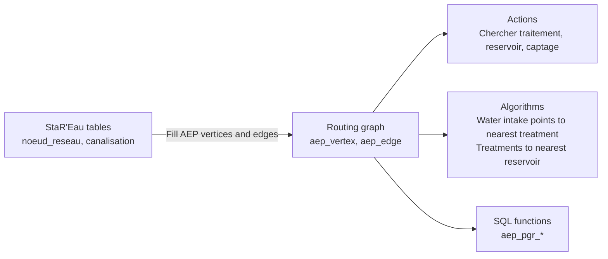

# Network analysis

The plugin uses the **pgRouting** extension to find paths on the **drinking water network** (AEP).
See [pgRouting](../installation/index.md#pgrouting) to install the extension.

The sanitation network (ASS) is walked **without pgRouting**, by following the direction of the pipes:
see the actions [Upstream and Downstream](qgis-project.md#upstream-and-downstream-of-a-sanitation-node).

## Routing graph

The pgRouting functions do not use the StaR'Eau tables directly, but a **routing graph**
stored in two tables of the schema `stareau`:

| Table | Content |
|-------|---------|
| `aep_vertex` | The **vertices**: the AEP network nodes, with the same identifier as the node (`id` = `fid` of the node), and the missing nodes of the AEP network, with `fictif = True` |
| `aep_edge` | The **edges**: the AEP pipes, with the same identifier as the pipe (`id` = `fid` of the pipe), their `source` and `target` vertices, and their length as `cost` and `reverse_cost` |

The water can flow **in both directions** in the graph: the direction of the pipes is not used.

The graph is built by the algorithm [Fill AEP vertices and edges](processing.md#fill-aep-vertices-and-edges).
It is **not updated automatically**: run this algorithm again after each modification of the drinking water
network, otherwise the results of the analysis can be wrong, or an error can occur.

## Path to the nearest target

From a node of the drinking water network, the function `stareau.aep_pgr_path_to_nearest_target`
returns the pipes of the **shortest path** to the **nearest target**:

1. the **10 targets** closest to the node (as the crow flies) are selected in the target table,
   e.g. `aep_reservoir`,
2. the shortest paths to these targets are calculated on the graph (bidirectional Dijkstra),
3. the **shortest path** is kept, and its pipes are returned.

The variant `stareau.aep_pgr_path_to_nearest_target_avoiding_closed_valves` does the same,
but the **closed valves** (`etat_ouverture = 'fermee'`) cannot be crossed.

This calculation is used by:

* the layer actions `Chercher traitement`, `Chercher reservoir` and `Chercher captage`,
  see [Path to the nearest target](qgis-project.md#path-to-the-nearest-target),
* the algorithms [Water intake points to nearest treatment](processing.md#water-intake-points-to-nearest-treatment)
  and [Treatments to nearest reservoir](processing.md#treatments-to-nearest-reservoir),
  which run it for each water intake or for each treatment plant.

## Nearest valves

From a point located on a drinking water pipe, the function `stareau.aep_pgr_nearest_vannes`
returns the **valves to close to isolate this point**: the first valves met in each direction
when walking the network from the point. The valves are **dead ends**: the walk stops at the first valve.

The variant `stareau.aep_pgr_nearest_closed_vannes` only considers the **closed valves**:
the open valves are crossed, and the walk stops at the first closed valves.
It helps to find the **closed valves which isolate** a part of the network.

These functions are used by the action [Nearest valves](qgis-project.md#nearest-valves).

See [Useful functions](../database-guide/functions.md#network-analysis-functions-pgrouting) for the parameters of these functions.
