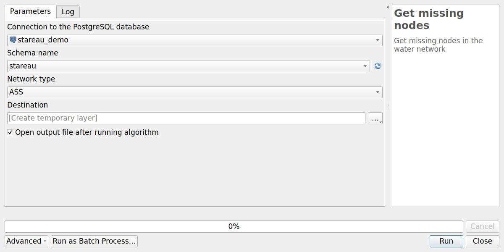
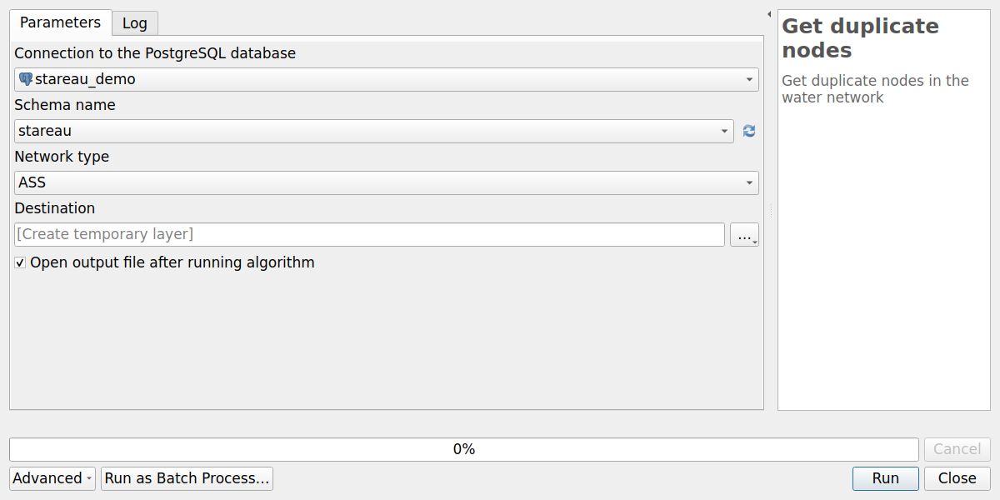
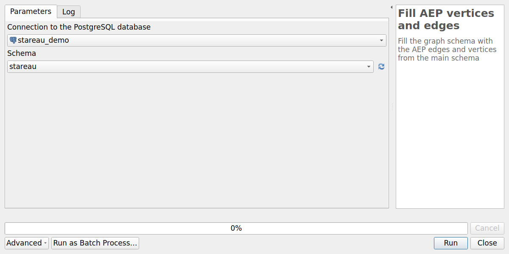
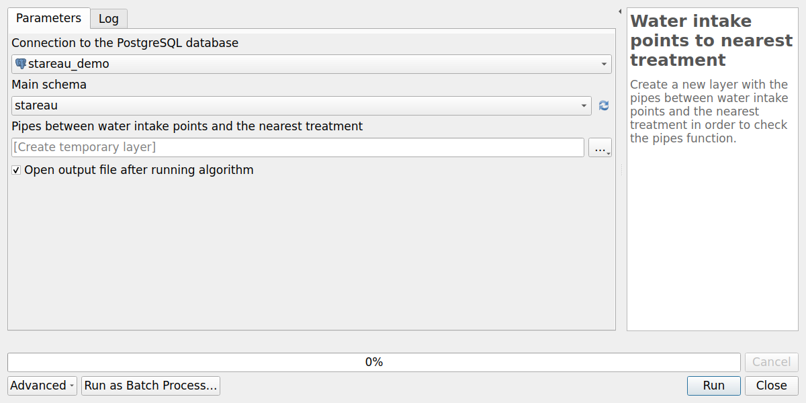
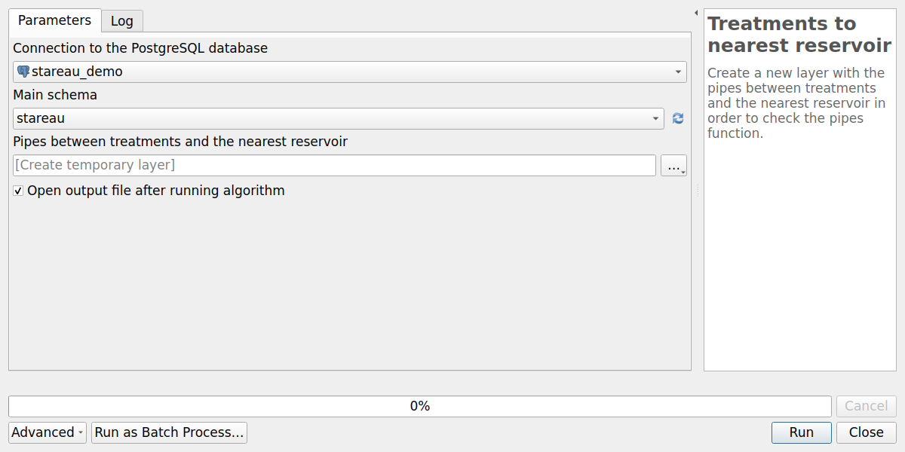

# Processing algorithms

The plugin adds the provider **StarEau** to the QGIS **Processing toolbox** (menu `Processing / Toolbox`).
All the algorithms are also available with the buttons of the [StarEau panel](qgis-project.md#administration-panel).

| Group | Algorithm | Usage |
|-------|-----------|-------|
| Configuration | [Configure plugin](#configure-plugin) | Choose the PostgreSQL connection of the project |
| Structure | [Create database structure](#create-database-structure) | Install the StaR'Eau schemas in the database |
| Structure | [Upgrade database structure](#upgrade-database-structure) | Upgrade the schemas after a plugin upgrade |
| Administration | [Create database local interface](#create-database-local-interface) | Create the QGIS administration project |
| Structure | [Get missing nodes](#get-missing-nodes) | Find the start and end points of the pipes without node |
| Structure | [Get orphan nodes](#get-orphan-nodes) | Find the nodes which are not linked to any pipe |
| Structure | [Get duplicate nodes](#get-duplicate-nodes) | Find the orphan nodes located at the same place as another node |
| Structure | [Fill AEP vertices and edges](#fill-aep-vertices-and-edges) | Build the routing graph of the drinking water network |
| Structure | [Water intake points to nearest treatment](#water-intake-points-to-nearest-treatment) | Pipes between each water intake and the nearest treatment plant |
| Structure | [Treatments to nearest reservoir](#treatments-to-nearest-reservoir) | Pipes between each treatment plant and the nearest reservoir |

All the algorithms have a parameter `Connection to the PostgreSQL database`:
by default, the connection chosen with the algorithm `Configure plugin`.

The algorithms are not available in the Processing **model designer**.

## Configuration

### Configure plugin

Choose the **PostgreSQL connection** used by the current QGIS project.
It must be run before the other algorithms.
See [Configure the plugin](../installation/index.md#configure-the-plugin).

## Structure

### Create database structure

Install the StaR'Eau schemas, with their tables and value lists, and the schema `stareau` of the plugin,
with its functions and triggers.
See [Create the database structure](../installation/index.md#create-the-database-structure).

### Upgrade database structure

Upgrade the database structure to the version of the plugin, after a plugin upgrade.
The StarEau panel shows if an upgrade is needed.
See [Upgrade database structure](../installation/index.md#upgrade-database-structure).

## Administration

### Create database local interface

Create a **QGIS administration project** with all the layers and actions.
See [Create your database local interface](../installation/index.md#create-your-database-local-interface)
and [Administration project](qgis-project.md#administration-project).

## Network checks

The three following algorithms help to find the **topology errors** of the network.
They have the same parameters:

* `Connection to the PostgreSQL database`,
* `Schema name`: the schema of the plugin. Default: `stareau`,
* `Network type`: `ASS` (sanitation network) or `AEP` (drinking water network),
* `Destination`: the output point layer.

The output layer is a **copy** of the result: run the algorithm again after correcting the data.

### Get missing nodes

Find the **missing nodes**: the start and end points of the pipes whose initial or terminal node
is `non_renseigne`. Two pipes ending at the same point give only one missing node.

The output layer `Missing nodes` contains the fields:

| Field | Description |
|-------|-------------|
| `fid` | Identifier of the missing node |
| `id_canalisation_upstream` | `id_canalisation` of the pipe **ending** at this point, if any |
| `id_canalisation_downstream` | `id_canalisation` of the pipe **starting** at this point, if any |

To correct the errors, create a network node at the location of each missing node:
the pipes are then linked automatically to the new node, see [Network topology](topology.md#create-a-node).

### Get orphan nodes

Find the **orphan nodes**: the network nodes which are neither the initial node nor the terminal node of any pipe.

The output layer `Orphan nodes` contains the fields of the table `noeud_reseau`.
It can be a normal situation, for example for an isolated object, or an error, for example a node
drawn more than 10 cm away from the end of a pipe.

### Get duplicate nodes

Find the **duplicate nodes**: the orphan nodes located **at the same place** as another network node.

The output layer `Duplicate nodes` contains the fields of the table `noeud_reseau`.
These nodes can usually be deleted.

## Network analysis

These algorithms work on the **drinking water network**, and need the **pgRouting** extension.
See [Network analysis](network-analysis.md).

### Fill AEP vertices and edges

Build the **routing graph** of the drinking water network, used by the pgRouting functions:
the tables `stareau.aep_vertex` and `stareau.aep_edge` are emptied, then filled with:

* the **vertices**: the AEP network nodes, and the [missing nodes](#get-missing-nodes) of the AEP network
  (`fictif = True`),
* the **edges**: the AEP pipes, between their initial and terminal vertices.
  The cost of an edge is the length of the pipe, in both directions.

Parameters:

* `Connection to the PostgreSQL database`,
* `Schema`: the schema of the plugin. Default: `stareau`.

The graph is **not updated automatically**: run this algorithm again after each modification
of the drinking water network, before using the network analysis tools.

### Water intake points to nearest treatment

For each **water intake** (`aep_captage`), find the path to the **nearest treatment plant** (`aep_traitement`)
on the drinking water network, and create a layer with the pipes of these paths.

Parameters:

* `Connection to the PostgreSQL database`,
* `Main schema`: the schema of the plugin, e.g. `stareau`,
* `Pipes between water intake points and the nearest treatment`: the output line layer.

The output layer `Pipes layer` contains the fields of the table `aep_canalisation`,
and is styled by **pipe function** (`fonction_canalisation`): `adduction`, `transport`,
`transport-distribution`, `distribution`.
It helps to **check the function of the pipes**: the pipes carrying the raw water from the
water intakes to the treatment plants should be `adduction` pipes.

### Treatments to nearest reservoir

For each **treatment plant** (`aep_traitement`), find the path to the **nearest reservoir** (`aep_reservoir`)
on the drinking water network, and create a layer with the pipes of these paths.

Parameters:

* `Connection to the PostgreSQL database`,
* `Main schema`: the schema of the plugin, e.g. `stareau`,
* `Pipes between treatments and the nearest reservoir`: the output line layer.

The output layer `Pipes layer` is styled by **pipe function**, like the previous algorithm.
