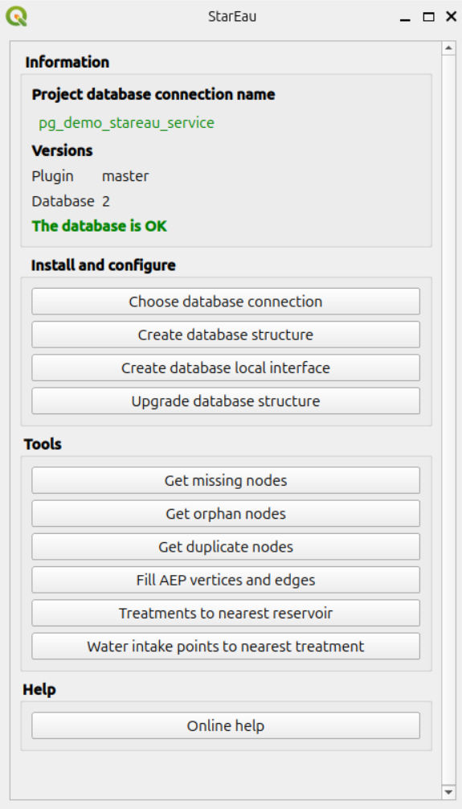

# QGIS project and tools

## Administration project

The algorithm [Create database local interface](../installation/index.md#create-your-database-local-interface)
creates a **QGIS administration project** with the layers of all the tables of the database,
and the actions needed to manage the network.

The project contains the following groups of layers:

* `AEP`: the drinking water network, schemas `stareau_aep` and `stareau_aep_brcht`:
  pipes, service connections, water intakes, treatment plants, reservoirs, valves, pumping stations, etc.,
* `ASS`: the sanitation network, schemas `stareau_ass` and `stareau_ass_brcht`:
  pipes, service connections, manholes, outlets, basins, pumping stations, collection points, etc.,
* `Commun`: the shared objects of the schema `stareau_commun`: geolocation points, rain gauges, piezometers,
  and the fire water points `pei`,
* `Valeurs`: the value lists of the schema `stareau_valeur`,
* `Bases`: the parent tables of the schema `stareau_principale`:
    * `noeud_reseau`: all the network nodes, of all the networks,
    * `canalisation`: all the pipes, of all the networks,
    * `emprise`: the footprints.

The layers of the group `Bases` show the objects of all their child tables
(see [Table inheritance](../concepts/index.md#table-inheritance)).
To create a new object, use the layer of its **specific table**, for example `aep_vanne` for a valve
or `ass_canalisation` for a sanitation pipe.

## Panel and menu

### Administration panel

The panel **StarEau** is used by the administrator to install and configure the database,
and to run the tools of the plugin:

* the group `Information` shows the **PostgreSQL connection** used by the project,
  the **versions** of the plugin and of the database structure, and checks that they match:
    * `The database is OK`: nothing to do,
    * `The database version is older than your plugin version`: run the algorithm
      [Upgrade database structure](../installation/index.md#upgrade-database-structure),
    * `The required schema version is older than the database structure version`: upgrade the plugin,
* the group `Install and configure` runs the algorithms `Configure plugin` (button `Choose database connection`),
  `Create database structure`, `Create database local interface` and `Upgrade database structure`,
* the group `Tools` runs the algorithms which check and analyse the network:
  `Get missing nodes`, `Get orphan nodes`, `Get duplicate nodes`, `Fill AEP vertices and edges`,
  `Treatments to nearest reservoir` and `Water intake points to nearest treatment`,
* the group `Help` opens this documentation.

The buttons are disabled, except `Choose database connection`, while the project has no valid
database connection: run the algorithm [Configure plugin](../installation/index.md#configure-the-plugin) first.



See [Processing algorithms](processing.md) for the description of these algorithms.

### Menu

The menu `Help / Plugins / StarEau` opens this documentation.

## Layer actions

Some layers of the administration project have **actions**, run by the StarEau plugin,
which must be installed and activated:

| Layers | Action | Usage |
|--------|--------|-------|
| `canalisation`, `aep_canalisation`, `aep_canalisation_branchement`, `ass_canalisation`, `ass_canalisation_branchement` | [Inverser la canalisation](#reverse-a-pipe) | Reverse the direction of the pipe |
| `aep_vanne` | [Fermer la vanne](#close-or-open-a-valve) | Close the valve |
| `aep_vanne` | [Ouvrir la vanne](#close-or-open-a-valve) | Open the valve |
| `aep_captage`, `aep_vanne` | [Chercher traitement](#path-to-the-nearest-target) | Show the pipes to the nearest treatment plant |
| `aep_traitement`, `aep_reservoir`, `aep_vanne` | [Chercher reservoir](#path-to-the-nearest-target) | Show the pipes to the nearest reservoir |
| `aep_traitement`, `aep_vanne` | [Chercher captage](#path-to-the-nearest-target) | Show the pipes to the nearest water intake |
| ASS node layers: `ass_regard`, `ass_pompage`, `ass_bassin`, `ass_exutoire`, `ass_traitement`, `ass_pretraitement`, `ass_piece`, `ass_raccord`, `ass_point_collecte`, `ass_engouffrement_point`, `ass_ouvrage_special_point`, `ass_chambre_depollution` | [Downstream](#upstream-and-downstream-of-a-sanitation-node) | Show the pipes downstream of the node |
| same ASS node layers | [Upstream](#upstream-and-downstream-of-a-sanitation-node) | Show the pipes upstream of the node |

To run an action on a feature, use the `Identify Features` tool and **right-click** on the feature in the map,
or use the `Run Feature Action` tool of the `Attributes` toolbar.

The Python code of these actions is stored in the plugin: the actions of the project only call it,
for example:

```python
from qgis.utils import plugins

plugins['stareau'].run_action(
    'fermer_vanne',
    fid_vanne = [% fid %],
    id_layer = '[% @layer_id %]',
)
```

The same code can be used to add the actions to the layers of another QGIS project.
The action must be of type `Python`. The layer must be a **PostgreSQL layer** of a StaR'Eau table:
the actions check the geometry type and the fields of the layer, and display an error message in the
QGIS message bar if the layer is not valid.

### Reverse a pipe

Action `inverser_canalisation`: reverses the **direction of the line** of the pipe.

Parameters: `fid_canalisation` (the `fid` of the pipe) and `id_layer` (a line layer).

The trigger functions of the database then update the initial and terminal nodes of the pipe,
see [Network topology](topology.md). Use it when a pipe has been drawn in the wrong direction,
for example against the flow direction of a sanitation network.

### Close or open a valve

Actions `fermer_vanne` and `ouvrir_vanne`: set the field `etat_ouverture` of the valve
to `fermee` (closed) or `ouverte` (open).

Parameters: `fid_vanne` (the `fid` of the valve) and `id_layer` (a point layer with the field `etat_ouverture`).

The closed valves are used by the [network analysis](network-analysis.md) functions which avoid closed valves.

### Path to the nearest target

Action `aep_pgr_path_to_nearest_target`: walks the **drinking water network** from the clicked node,
and adds to the project a layer `path_to_<target_table>` with the pipes between the node
and the **nearest target**: water intake, treatment plant or reservoir.

Parameters:

* `fid_noeud`: the `fid` of the node,
* `id_layer`: a point layer of a drinking water node table,
* `target_table`: the table of the targets, starting with `aep_`, e.g. `aep_traitement`, `aep_reservoir` or `aep_captage`,
* `avoiding_closed_valves`: `False` or `True`. If `True`, the closed valves cannot be crossed.

```python
from qgis.utils import plugins

plugins['stareau'].run_action(
    'aep_pgr_path_to_nearest_target',
    fid_noeud = [% fid %],
    id_layer = '[% @layer_id %]',
    target_table = 'aep_reservoir',
    avoiding_closed_valves = False,
)
```

!!! note
    All the parameters of an action must be given in the action code, even the ones with a default value
    in the Python function: otherwise the error `Arguments invalides` is displayed.

The message `Aucun chemin n'a été trouvé pour atteindre la cible` is displayed if no path is found.

This action needs **pgRouting** and an up to date **routing graph**:
run the algorithm [Fill AEP vertices and edges](processing.md#fill-aep-vertices-and-edges)
after editing the drinking water network. See [Network analysis](network-analysis.md).

### Upstream and downstream of a sanitation node

Actions `ass_downstream` and `ass_upstream`: walk the **sanitation network** from the clicked node,
following the direction of the pipes, and add to the project a layer `Downstream` or `Upstream`
with all the pipes located **downstream** or **upstream** of the node.

Parameters: `id_noeud` (the `id_noeud_reseau` of the node) and `id_layer` (a point layer with the field `id_noeud_reseau`).

The walk stops at the pipes whose initial or terminal node is missing (`non_renseigne`).
These actions do not need pgRouting.

### Nearest valves

Action `aep_pgr_nearest_vannes`: finds the **valves to close to isolate** a point of a drinking water pipe,
and adds them to the project in a layer `vannes_trouvées`.
This action is not configured in the administration project, but it can be added on a pipe layer,
for example with the coordinates of the click on the map (action scope `Canvas`):

```python
from qgis.utils import plugins

plugins['stareau'].run_action(
    'aep_pgr_nearest_vannes',
    id_layer = '[% @layer_id %]',
    point_x = [% @click_x %],
    point_y = [% @click_y %],
    closed_valves_only = False,
)
```

Parameters:

* `id_layer`: a line layer of drinking water pipes,
* `point_x`, `point_y`: the coordinates of the point, in `EPSG:2154`,
* `closed_valves_only`: `False` or `True`. If `True`, only the **closed valves** are searched,
  and the open valves can be crossed.

See [Nearest valves](../database-guide/functions.md#nearest-valves) for the details of the calculation.
